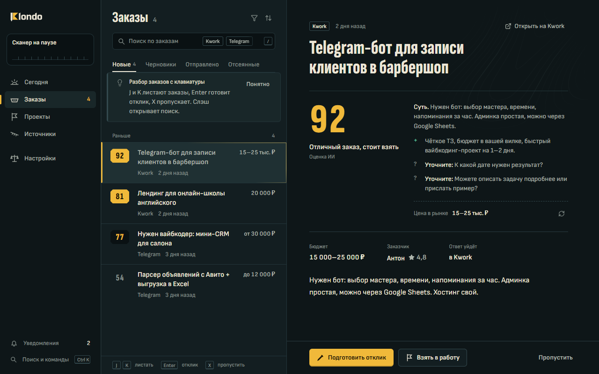
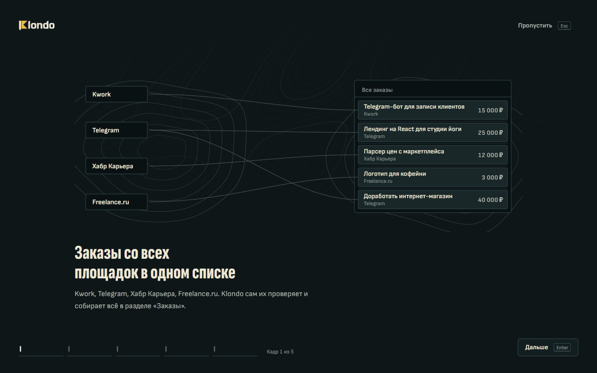

<div align="center">



<br>

<a href="https://github.com/nyryxdev/klondo/releases/latest"></a>
<a href="https://github.com/nyryxdev/klondo/releases"></a>
<a href="https://klondo.app"></a>
<a href="https://t.me/klondo_app"></a>

</div>

Здесь лежат установщики Klondo.

Klondo — приложение для фрилансера. Оно проверяет Kwork, Freelance.ru, Хабр Карьеру и Telegram, отсеивает лишнее по вашим правилам, оценивает каждый заказ от 0 до 100 и готовит черновик отклика. Работает на вашем компьютере, без регистрации.



## Скачать

Последняя версия: **[Releases → Latest](https://github.com/nyryxdev/klondo/releases/latest)**.

| Система | Файл | Как поставить |
|---|---|---|
| Windows 10 / 11, x64 | `Klondo-Setup-<версия>.exe` | запустить установщик |
| Linux x64, любой дистрибутив | `Klondo-<версия>-x86_64.AppImage` | `chmod +x Klondo-*.AppImage && ./Klondo-*.AppImage` |
| Ubuntu, Debian, Mint, x64 | `Klondo-<версия>-amd64.deb` | `sudo apt install ./Klondo-*.deb` |

macOS, Android и iOS не поддерживаются. С телефона Klondo управляется через личного Telegram-бота: новые заказы приходят туда с кнопками «Беру» и «Пропустить».

## Проверить файл

К каждой версии приложен `SHA256SUMS.txt`. Сравните сумму со своим файлом:

```powershell
# Windows, PowerShell
Get-FileHash .\Klondo-Setup-*.exe -Algorithm SHA256
```

```bash
# Linux
sha256sum -c SHA256SUMS.txt --ignore-missing
```

Если суммы не совпадают, не запускайте файл. Напишите в [@klondo_app](https://t.me/klondo_app).

## Первый запуск

**Windows.** Установщик пока не подписан сертификатом, поэтому SmartScreen может показать «Система Windows защитила ваш компьютер». Нажмите «Подробнее» → «Выполнить в любом случае». Подпись появится в одной из следующих версий.

**Linux.** Ключи ИИ и сессия Telegram хранятся в системном хранилище паролей: GNOME Keyring или KWallet. Без него Klondo работает, но не сохраняет секреты и скажет об этом в настройках.

**Обновления.** Версия для Windows и AppImage обновляются сами. Пакет `.deb` нужно обновлять вручную: скачайте новый файл и поставьте поверх старого. База и настройки сохраняются при обновлении и удалении.

## Тарифы

| | Free | Pro |
|---|---|---|
| Цена | 0 ₽, без срока | 490 ₽ / мес или 3 900 ₽ / год, без автосписаний |
| Площадки | Kwork, 2 Telegram-канала | все, включая Telegram-чаты |
| Оценка и отклики ИИ | на своём ключе | на своём ключе |
| Проекты с папкой, «Клиенты», объявления в Telegram | — | да |

Купить: [klondo.app/buy](https://klondo.app/buy/). Карты РФ и СНГ или USDT через xRocket. Ключ приходит сразу, почта не нужна.

## Данные

- База и настройки хранятся только на вашем компьютере.
- Наружу уходят запросы к площадкам и текст заказа выбранному ИИ-провайдеру. Список адресов: [klondo.app/security](https://klondo.app/security/).
- Нет телеметрии и регистрации.

## Ошибки и предложения

- Ошибка: [новый Issue](https://github.com/nyryxdev/klondo/issues/new). Укажите версию (Настройки → О программе), систему и шаги. Не прикладывайте ключи, токены и переписку.
- Вопросы и новости: [@klondo_app](https://t.me/klondo_app).
- Уязвимость: не в Issues, а личным сообщением в [@klondo_app](https://t.me/klondo_app).

<p align="center">
  
  
</p>

---

<sub>© 2026 Klondo.
Подробно: [LICENSE](LICENSE) и [оферта](https://klondo.app/terms/).</sub>
